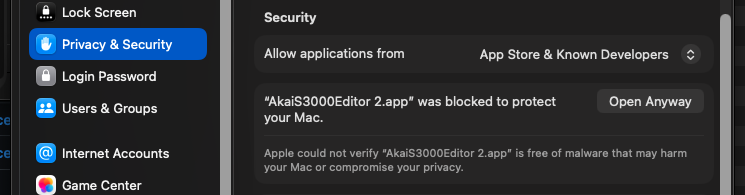
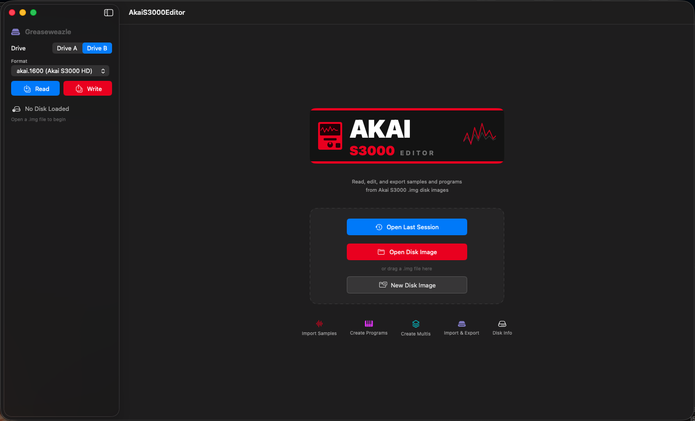
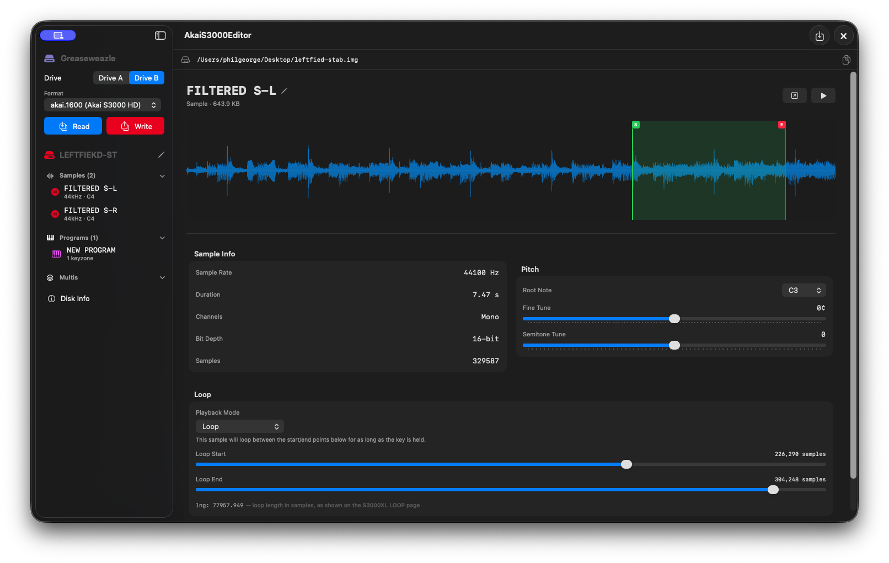
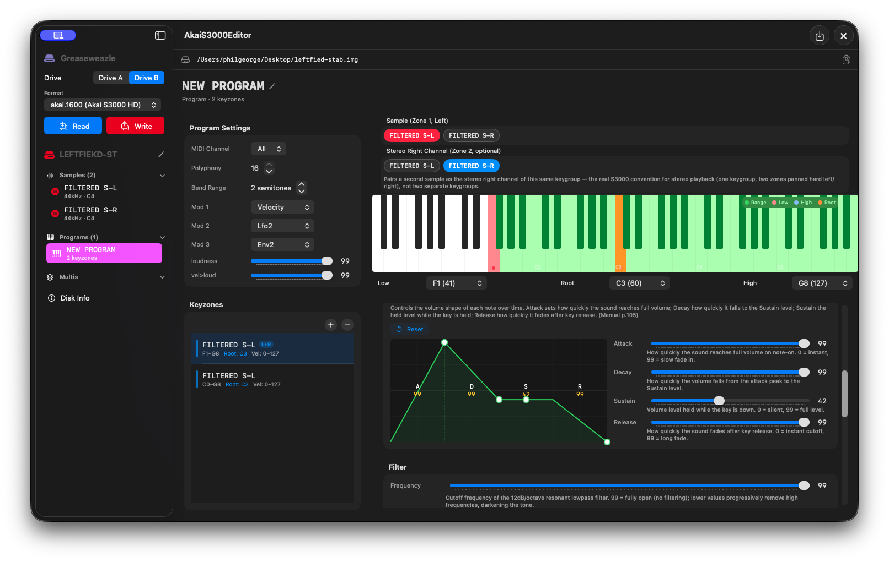
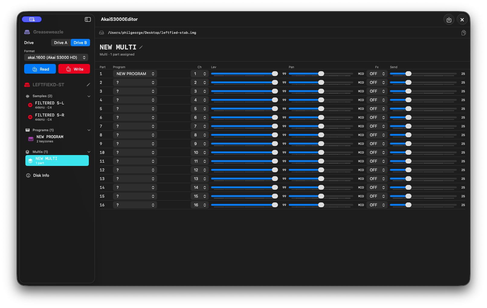
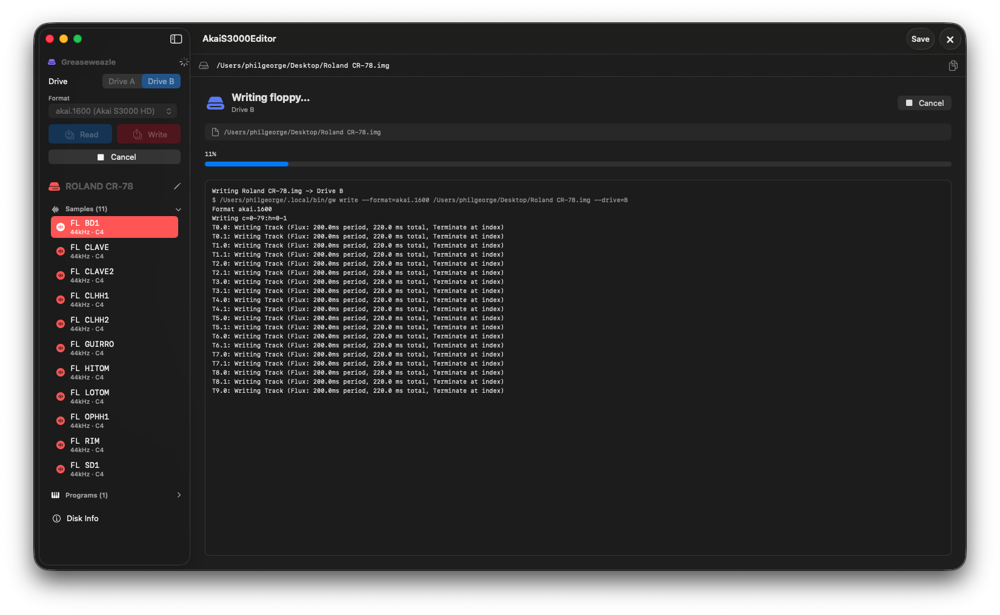
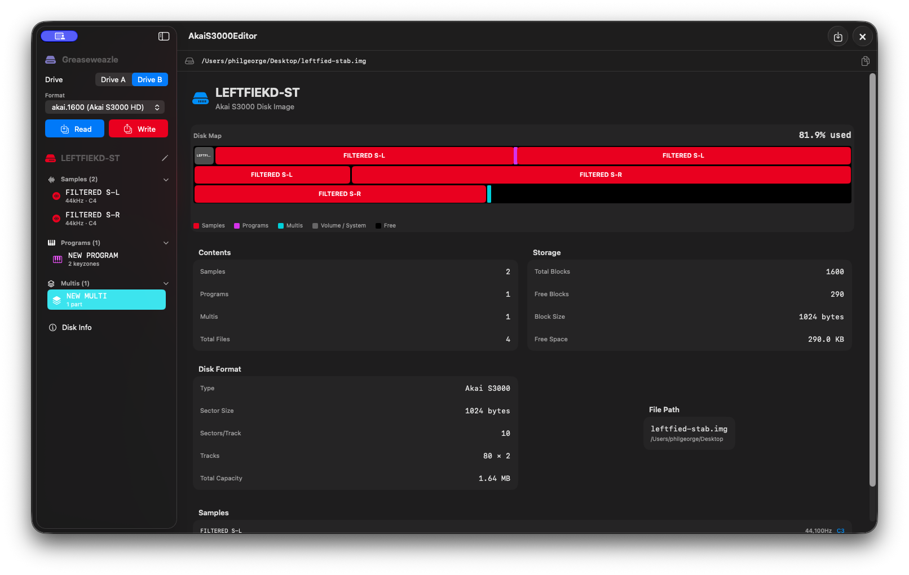

# Akai S3000 Floppy Disk Editor


This is a personal macOS project that allows me to read and write Akai S3000XL floppy disks using a UI that is super easy and powerful: quickly create programs, then drag and drop WAV files into keyzones with filter and loop settings, then save to an .img file. For reading and editing Akai S3000 floppy disk images (.img), I use the AMAZING [Greaseweazle](https://github.com/keirf/greaseweazle) floppy-to-USB-C card.

My app is built with SwiftUI — no dependencies — so it should run on most modern Macs. You will need to edit permissions in Settings to trust it, as it's not on the App Store yet!

**[View on GitHub](https://github.com/pageorge/Akai-S3000-Floppy-Disk-Editor)**

---

## Download

**[⬇️ Download latest build](https://github.com/pageorge/Akai-S3000-Floppy-Disk-Editor/releases/latest)**

1. Download `AkaiS3000Editor` from the link above
2. Run the App
3. On first launch modern Mac will say it can't run, go in to Settings -> Privacy & Security -> Open Anyway - I trust this guy!

<p align="center">
  
</p>

---

## Screenshots

<table>
  <tr>
    <td valign="top">
      <h3>Open last session, open an existing image or create a new image</h3>
      
    </td>
  </tr>
  <tr>
    <td valign="top">
      <h3>Drag in multiple wav/aiff samples and setup loop points</h3>
      
    </td>
  </tr>  
  <tr>    
    <td valign="top">
      <h3>Create or clone keyzones, drag samples in and choose single-key or full-keyboard layout. Set filter mods and ADSR graph</p>
      
    </td>
  </tr>
  <tr>
    <td width="50%" valign="top">
      <h3>Create multis and assign programs</h3>
      
    </td>
  </tr>
  <tr>
    <td width="50%" valign="top">
      <h3>Read / Write buttons call Greaseweazle commands and show log and progress writing to disk</h3>
      
    </td>
  </tr>
  
  <tr>
    <td valign="top">
      <h3>Floppy disk info and a map of where everything will be saved on disk</h3>
      
    </td>
  </tr>
  
</table>

---

## Requirements

- **macOS 14 Sonoma** or later
- No third-party dependencies

To build from source: **Xcode 15** or later.

---

## Building from source

1. Clone this repo
2. Open `AkaiS3000Editor.xcodeproj` in Xcode
3. Set your Development Team in Signing & Capabilities
4. Press **⌘R**

---

## Tips & Tricks

### Global settings are saved to disk

The S3000XL saves its global settings (master transpose, fine tune, MIDI channel assignments, etc.) into **blocks 0–4** of the floppy as part of a normal SAVE operation. When you load a disk, these settings are restored — including any transpose or tuning that was active when the disk was last saved.

**If samples play back at the wrong speed or pitch after loading a disk:** check the global TRANSPOSE and FINE TUNE settings (TUNE/MIDI button). A non-zero transpose saved to disk will affect all playback. Reset to zero and save back to the disk to fix it.

The app preserves blocks 0–4 faithfully when saving — it never modifies global settings. New disks created by the app initialise these blocks with hardware-captured factory defaults, byte-for-byte matching a freshly formatted S3000XL disk, ensuring correct global settings from the start.

### How to create a new program on the S3000XL

There's no separate "blank new program" function — every new program is made by copying an existing one (most simply, the built-in default TEST PROGRAM):

1. Go to EDIT PROGRAM → SINGLE
2. Press **NAME**, type your new program name (up to 12 characters, uppercase only), press **ENT**
3. Press **COPY** — this duplicates the current program under your new name

### How to assign samples to keyzones

Drag a WAV file (or folder of WAVs) onto a program in the main view. On the first drag, the app asks:

- **Single Key (C1, C#1, D1…)** — each sample maps to its own key starting at C1. Ideal for one-shots where you want each sound on a separate trigger key.
- **Full Keyboard (divide evenly)** — the keyboard range (C0–G8) is divided evenly across all samples. Ideal for pitched instruments.

This choice is remembered for the session. Subsequent drags onto the same program follow the same layout automatically.

### Sample root note

The sample's **root key** (`rkey`) tells the S3000 which pitch to play the sample at unity in TRACK mode. For single-key layouts, the app automatically sets `rkey` to match the trigger key (e.g. C1 for the first key) so each key plays its sample at recorded pitch.

`rkey` is stored on the **sample**, not the keyzone — if the same sample is used by two different keyzones on different keys, changing the root for one affects all uses of that sample.

### Clone Sample (shared PCM)

Right-click any sample in the sidebar → **Clone Sample**. This creates a second directory entry pointing to the same audio data on disk — no PCM bytes are duplicated, so the clone costs only a tiny directory entry (effectively free in terms of disk space).

Why this is powerful: the S3000 has no per-keyzone start or loop point — every keyzone referencing a sample uses the same trim and loop settings. If you want different parts of a long sample (e.g. a break or loop) to play on different keys, you'd normally have to duplicate the entire audio. Clone Sample sidesteps this: make several clones of the same sample, set a different start point or loop on each clone, then assign each clone to its own keyzone. You get multiple independent playback positions from a single copy of the audio on disk.

### Lo-fi / Convert to 22k

The "Convert to 22k" toggle in the Samples header downsamples imported WAVs from 44.1kHz to 22.05kHz, roughly halving their disk footprint. Use it when you need to fit more samples on one floppy. The bandwidth byte is automatically set to match the sample rate.

### How to use Multis

The S3000XL holds only one multi in memory at a time, but any number may be saved to disk (manual, p.35). Save named multis to disk and load whichever you need per session via **LOAD → MULTI+PROGS+SAMPS**.

**Note:** Hardware testing suggests the firmware always loads the first multi in the directory regardless of which file is selected from the load list. This appears to be a firmware behaviour.

---

## E-mu ESI Conversion

**File → Import E-mu ESI Disks… (⇧⌘I)** imports presets from E-mu ESI-32 / ESI-2000 / ESI-4000 and Emulator IIIX disks into the open Akai disk as programs and samples.

1. Open (or create) the Akai disk image you want to import into.
2. Choose the E-mu disk images: a floppy set of 1.44 MB `.img` files, or a single `.esi` / `.e3x` bank file. Picking just disk 1 is enough — the rest of the set is found automatically if it's in the same folder (disks are matched by their headers, not their file names).
3. Tick the presets you want. The sheet shows the keygroups, samples and KB each preset needs, and whether the selection fits on the Akai disk.
4. Import. Shared samples are only imported once.

An ESI bank often spans several floppies and won't fit on one 1.6 MB Akai disk, so pick a few presets at a time. **Downsample to 22.05 kHz** roughly halves the space needed.

### What gets converted

```
E-mu ESI                          Akai S3000
--------                          ----------
stereo sample                     -L / -R sample pair in one keygroup (zones 1 + 2)
loop + loop in release            Loop In Release
loop                              Loop Until Release
no loop                           No Loop
zone original key                 sample root key (rkey); other keys → keygroup tune
run of keys sharing a note zone   one keygroup (low/high key)
primary layer                     keygroup with the preset's primary velocity range
secondary layer                   overlapping keygroup with the secondary velocity range
zone tuning (cents)               keygroup semitone + fine tune
zone level 0-127                  keygroup loudness 0-99
zone pan 0-127                    keygroup pan ±50 (stereo pairs: hard L/R)
non-transpose flag                pitch CONST
loop-disable flag                 keygroup playback No Loop
amp envelope A/D/S/R              ENV1, scaled 0-127 → 0-99  ? (approximate)
bend range                        program bend range
```

**Not converted:** filters, LFOs, auxiliary envelope, preset links (layered preset chains), crossfade/switch note-zone options. Programs are capped at 99 keygroups. Original Emulator III (non-X) floppies aren't supported — their layout is undocumented.

**Status:** the E-mu reading side follows published, library-verified research (below). The Akai mapping is this project's own and is **not yet hardware-confirmed** — in particular the envelope scaling is a straight linear rescale between two non-linear tables, so attack/release times will likely need adjusting.

### E-mu format notes

```
Floppy set   raw 1.44 MB images (1,474,560 bytes), everything BIG-endian (68k memory dump)
  disk hdr   00 identifier[16]  ("EMU SI-32 v3" = ESI, "EMULATOR 3X" = EIIIX)
             10 bank name[16]   24 u32 = 1   28 u32 disk number   2c u32 total disks
  payload    bytes 0x200- of each disk, concatenated in disk order
             bank record  (bank-file offset B = payload offset B - 0x4c)
             ESI:   sample header table (1000 x 92 bytes), then PCM
             EIIIX: PCM, then sample header table
  quirks     zone flag byte stored bit-mirrored; sample addresses carry a bank flag
             in bit 26; loop end points one frame past the loop

Bank file    .esi / .e3x, same structures but LITTLE-endian, header in front of each sample
  0x17ca     preset table (257 entries)      0x1bd2   sample table (1000 entries)
  0x2b72     preset area: 142-byte preset + 4-byte note zones + 48-byte zones
```

### Sources

- [ConvertWithMoss](https://github.com/git-moss/ConvertWithMoss) by Jürgen Moßgraber — open-source multisample converter with Emulator III/IIIX/ESI support. The basis for this importer.
- [EIII_FORMAT.md](https://github.com/git-moss/ConvertWithMoss/blob/main/documentation/design/EIII_FORMAT.md) — the bank and floppy-set format, verified against the E-mu EIIIX / ESI-4000 library CD-ROMs and the E-mu and Sweetwater floppy libraries.
- [Emulator3FloppySet.java](https://github.com/git-moss/ConvertWithMoss/blob/main/src/main/java/de/mossgrabers/convertwithmoss/format/emu/emulator3/Emulator3FloppySet.java) — the floppy-set reader the Swift parser is ported from.
- [emu3bm](https://github.com/dagargo/emu3bm) by David García Goñi — the original reverse-engineering of Emulator III banks that the format doc builds on.
- [E-mu ESi factory floppy collection](https://archive.org/details/e-mu-esi-floppy-collection-v-1.-7z) (Internet Archive) — ESi factory and Sweetwater floppy sets, useful test material.

---

## Technical Reference: Akai S3000 Disk Format

Sources: [Ohsaki/akaitools](https://lsnl.jp/~ohsaki/software/akaitools/S3000-format.html), [Midi-In/akaiutil](https://github.com/Midi-In/akaiutil), [dialtr/akai-fs](https://github.com/dialtr/akai-fs), [keirf/GreaseWeazle](https://github.com/keirf/greaseweazle), Akai S3000XL Operator’s Manual, and direct hardware byte-diff testing on a real S3000XL.

All numbers little-endian. Akai character encoding: `0–9`=digits, `10`=space, `11–36`=A–Z, `37`=#, `38`=+, `39`=-, `40`=.

Key: `C`=byte, `v`=2-byte signed, `An`=n-byte Akai string, `x`=internal/sampler-managed, `*`=hardware-confirmed by this project, `?`=disputed or uncertain

---

### Physical layout (floppy)

```
akai.1600 (HD)   80 cylinders × 2 heads × 10 sectors × 1024 bytes = 1,638,400 bytes = 1600 blocks
akai.800  (DD)   80 cylinders × 1 head  × 10 sectors × 1024 bytes =   819,200 bytes =  800 blocks
```

---

### Disk structure

```
block 0–4     floppy header (akai_flhhead_s)
block 5–16    volume directory (510 × 24-byte entries, spans 12 blocks)
block 17+     file data (FAT-chained)
```

#### Floppy header block 0 — 64 × 24-byte slots

```
00-0b    A12   volume name (Akai-encoded, repeated in every slot)
0c-0d    C2    00 00
0e-0f    C2    04 0b  (tag)
10       C     ff=slot 0 (volume sentinel), 00=other slots
12       C     10     (undocumented field, hardware-confirmed *)
17       C     11     (osver)
```

The S3000XL rewrites block 0 on every save, and what it writes varies ?: one save
left every slot as spaces (`0x20`) with `0x12`=`00`; a later save (after a multi
was loaded) filled every slot with the multi's name (`NEW MULTI`) and `0x12`=`10`.
It doesn't seem to matter what we write here — the sampler overwrites it.

#### Volume label — absolute offset 0x1280 (block 4 + 0x280)

```
1280-128b  A12   volume name *
128c-128e  C3    00 00 00 *
128f       C     11  osver *
1290-1291  C2    00 00
```

**Nothing here is free space** — `0x128c–0x1299` is all label/global data the
sampler reads (see Global settings below for `0x1292–0x1299`).

When the S3000XL saves a floppy it may replace the volume name with `NOT NAMED` ?
(seen once: a disk named `NEW-DISK` came back as `NOT NAMED`).

#### Global settings — block 4 offset 0x292 (absolute 0x1292)

```
292-299  C8    01 00 00 00 32 09 0c ff   factory defaults *
                                          leaving zero → corrupt transpose on load
293      C     selected program, 0-indexed (00 = program 1 on the SLCT screen) *
```

#### FAT — one 16-bit LE entry per block

```
0000    free
4000    system (reserved)
c000    end of file chain
other   next block number
```

#### Volume directory entry — 24 bytes

```
00-0b    A12   file name
0c-0f    C4    tag (S3000 free = 00)
10       C     file type:
                 f3 = S3000 sample
                 f0 = S3000 program
                 ed = multi
                 64 = drum inputs (SAVE→DRUM)
                 78 = effects file
                 74 = take list
11-13    C3    file size in bytes (24-bit LE)
14-15    C2    start block
16-17    C2    osver (samples=0000, programs=1100)
```

---

### Sample file (type f3)

```
0000-00bf    sample header
00c0-        PCM data (16-bit signed LE mono)
```

#### Sample header — 0xc0 bytes

```
00       C     03  (S3000 block id)
01       C     bandwidth: 0=10kHz (≤22kHz), 1=20kHz (≥33kHz)  *derived from srate
02       C     original pitch / root key (24-127 = C0-G8)  *
03-0e    A12   sample name
0f       C     80 = sample rate valid
10       C     # of active loops (lnum): 0=none, 1=looping  *must match pmode
11       C     first active loop (internal)
12       C     dummy
13       C     playback type: 0=loop, 1=loop until release, 2=no loop, 3=play to end
14       C     pitch offset cents / 256 (fine tune)
15       C     pitch offset semitones
16-19    x4    data absolute start address (sampler RAM, internal)
1a-1d    C4    data length in samples (slen)
1e-21    C4    play start address (TRIM start, draggable in app *)
22-25    C4    play end address
26-85           8 loop slots, each 12 bytes:
  +00-03  C4    loop at  (right-hand boundary; region is [at-len, at) )
  +04-05  C2    loop len decimal / 65536 (flen, read for rounding, written as 0)
  +06-09  C4    loop len
  +0a-0b  C2    loop time: 0=off, 9999=hold, 1-9998=ms
                  * ALL 8 slots must be 0 for no-loop; 9999 in any slot forces loop
                  * app replicates active loop into slots 0-3 when looping
86-87    C2    dummy
88-89    x2    stereo partner address (0xffff=none)
8a-8b    C2    sample rate in Hz
8c       C     hold loop tune offset
8d-bf           reserved / unknown
```

---

### Program file (type f0)

```
0000-00bf    program common data
00c0-017f    keygroup 1
0180-023f    keygroup 2
  ...
```

#### Program common data — 0xc0 bytes

```
00       C     01  (program block id)
01-02    x2    1st keygroup address (internal)
03-0e    A12   program name
0f       C  0  MIDI program number (0-127)
10       C  0  MIDI channel (0-15, ff=omni)  *
11       C 31  polyphony (value = voices-1, so 31=32 voices)  *
12       C  1  priority: 0=low, 1=normal, 2=high, 3=hold  *
13       C 24  play range low (24-127 = C0-G8; 24 is the floor — manual p.64, sampler won't go lower)  *
14       C127  play range high
15       C  0  TRANS (MIDI page transpose) ±50 semitones, default 0  *  [Ohsaki: octave shift ±2]
16       C ff  individual output (0-7, ff=off)
17       C 99  stereo level 0-99  *
18       C  0  stereo pan
19       C 80  loudness 0-99, default 80 (manual p.26; 99 = no velocity sensitivity)  *
1a       C 20  velocity > loud, signed ±50, default +20 (manual)  *
1b       C  0  key > loud
1c       C  0  pressure > loud
1d       C  0  pan LFO rate
1e       C 99  pan depth
1f       C  0  pan LFO delay
20       C  0  key > pan position
21       C 50  LFO1 speed  * (factory = 50)
22       C  0  LFO fixed depth
23       C  0  LFO delay
24       C 30  modwheel > depth
25       C  0  pressure > depth
26       C  0  velocity > depth
27       C  2  bendwheel > pitch (bend up 0-24)  *
28       C  0  pressure > pitch  *
29       C  0  keygroup crossfade (0=off, 1=on)
2a       C  #  # of keygroups (1-99)  *
2b       C n/a temporary program number (internal)
2c-37    C12   key temperament
38       C  0  echo output level (0=off, 1=on)
39       C  0  modwheel pan amount
3a       C  0  sample start coherence (0=off, 1=on)
3b       C  0  LFO de-sync (0=off, 1=on)
3c       C  0  pitch law
3d       C  0  voice assign: 0=oldest, 1=quietest  *
3e       C 10  soft pedal loudness reduction
3f       C 10  soft pedal attack stretch
40       C 10  soft pedal filter close
41-42    v  0  tune offset
43       C  0  key > LFO rate
44       C  0  key > LFO depth
45       C  0  key > LFO delay
46       C 50  card (effects) out level 0-99 — MIX page, single mode  *  [Ohsaki: voice output scale, default 50]
47       C  0  stereo output scale
48-bf           reserved / unknown (except below) — for unmapped bytes, the factory
                TEST PROGRAM's values are a safe default (every mapped field matches it)
6e       C  0  portamento rate/time 0-99  *
6f       C  0  portamento type 0=rate, 1=time  *
70       C  0  portamento 0=off, 1=on  *
72       C 25  FX send 0-99  *
49       C  2  bend down 0-24 (default 2)  *
4a       C  0  bend mode: 0=normal, 1=held  *
54       C  5  filter mod source #1 (0-13, see below)  *
55       C  8  filter mod source #2  *
56       C 10  filter mod source #3  *
```

#### Keygroup — 0xc0 bytes each

```
00       C  2  keygroup block id
01-02    x2    next keygroup address (internal)
03       C 24  keyrange low  *
04       C127  keyrange high  *
05-06    v  0  tune offset
07       C 99  filter freq. 0-99  *
08       C  0  key > filter freq. (factory default 0, not manual’s +12)  *
09       C  0  velocity > filter freq.
0a       C  0  pressure > filter freq.
0b       C  0  envelope > filter freq.
0c       C 25  amp. attack  *
0d       C 50  amp. decay  *
0e       C 99  amp. sustain  *
0f       C 45  amp. release  *
10       C  0  velocity > amp. attack
11       C  0  velocity > amp. release
12       C  0  off velocity > amp. release
13       C  0  key > decay & release
14       C  0  filter attack (ENV2 rate 1)  *
15       C 50  filter decay (ENV2 rate 3)  *
16       C 99  filter sustain (ENV2 level 3)  *
17       C 45  filter release (ENV2 rate 4)  *
18       C  0  velocity > filter attack
19       C  0  velocity > filter release
1a       C  0  off velocity > filter release
1b       C  0  key > decay & release
1c       C 25  velocity > filter envelope output
1d       C  0  envelope > pitch
1e       C  1  velocity zone crossfade (0=off, 1=on)
1f       C n/a # of velocity zones (internal)
20-21    C2n/a internal  *must be 0xffff or zone 1 is silent
22-82           4 velocity zones (0x18 bytes each, see below)
83       C  0  fixed rate detune
84       C  0  attack hold until loop  [Ohsaki] / pitchMode TRACK/CONST [our use]  ?
85-88    C4 0  constant pitch zones 1-4: 0=track, 1=const  [Ohsaki]
89-8c    C4 0  output number offset zones 1-4
8d-94    v4 0  velocity > sample start zones 1-4
95       C  0  resonance 0-15  *
96-bf           reserved / unknown
97       C  0  vel. > filter freq. (filter mod depth #1)  *
98       C  0  pres. > filter freq. (filter mod depth #2)  *
99       C  0  env. > filter freq. (filter mod depth #3)  *
9c       C 99  ENV2 level 1  *
9d       C 50  ENV2 rate 2  *
9e       C 99  ENV2 level 2  *
9f       C  0  ENV2 level 4  *
96       C 50  LFO1 > pitch 0-99  *
a0       C ff  mute group: ff=OFF, 00=group 1 … 1f=group 32  *
a2       C 25  FX send 0-99 (per keygroup)  *
```

#### Velocity zone — 0x18 bytes (4 zones at keygroup offsets 0x22, 0x3a, 0x52, 0x6a)

```
00-0b    A12   sample name
0c       C  0  velocity low
0d       C127  velocity high
0e       C  0  tune offset cents / 256
0f       C  0  tune offset semitones
10       C  0  loudness offset, signed ±50 (manual; factory TEST PROGRAM = 0)  *
11       C  0  filter freq. offset
12       C  0  pan offset
13       C  0  loop mode: 0=sample setting, 1=loop, 2=loop until release,
                           3=no loop, 4=play to end
14-15    C2    reserved
16-17    x2    sample header block address (internal)

Zone 1 = primary sample. Zone 2 = stereo right channel (panned hard L/R).
Zones 3-4 unused in this app.
```

#### Filter mod sources (0x54-0x56, index 0-13)

```
 0  No Source    7  Key
 1  Modwheel     8  Lfo1
 2  Bend         9  Lfo2
 3  Pressure    10  Env1
 4  External    11  Env2
 5  Velocity    12  !Modwheel
 6  (unused)    13  !Bend      14  !External
```

---

### Multi file (type ed)

```
0000-03ff    multi header
0400-04bf    part 1
04c0-057f    part 2
  ...        (16 parts, 0xc0 bytes each)
```

#### Multi header

```
000-002    C3    00 00 00
003-00e    A12   internal name (Akai reads this, not the directory entry name)  *
00f-3ff           unknown, preserved
```

#### Part record — 0xc0 bytes (base = 0x400 + (N-1) * 0xc0)

```
+00      C     01  (record marker)
+01-02   x2    program link pointer (internal)
+03-0e   A12   program name  *
+0f      C     padding
+10      C     MIDI channel 0-indexed  *
+11      C     unknown, preserved
+12      C  1  priority 0=low 1=norm 2=high 3=hold (mirrors program 0x12)  *
+13      C 24  key range low  (mirrors program 0x13)  *
+14      C127  key range high (mirrors program 0x14)  *
+15      C     unknown, preserved
+16      C ff  individual output: ff=OFF, 0-7 = out 1-8 (mirrors program 0x16)  *
+17      C 99  level 0-99  *
+18      C     pan signed  *
+19-45   C45   unknown (TUNE/RNGE/PRIO), preserved
+46      C 50  output level 0-99 (mirrors program 0x46)  *
+47-70   C42   unknown, preserved
+71      C     FX bus: 0=off, 1=FX1, 2=FX2, 3=RV3, 4=RV4  *
+72      C     FX send 0-99  *
+be-bf   C2    end link pointer: ffff=unassigned  *must be ffff or wrong multi loads
```

---

### Default discrepancies (manual vs hardware)

```
Filter Key Follow    manual says +12    hardware shows 0   *
```

---

### Cross-reference: disputed or unconfirmed offsets

```
Keygroup 0x84  Ohsaki: attack hold until loop
               This app: pitchMode TRACK/CONST
               Ohsaki also notes "84??" next to 0x85-88 constant pitch
               Status: hardware-confirmed TRACK/CONST works at 0x84 *
                       but Ohsaki’s 0x85-88 layout not yet tested  ?

Keygroup 0x85-88  Ohsaki: constant pitch zones 1-4 (0=track, 1=const)
               This app: writes pitchMode at 0x84 only (zone 1)
               Status: zones 2-4 pitch mode unverified  ?
```

---

### Field knowledge cross-reference

Status codes: `agree`=all sources agree, `our finding`=not in Ohsaki or manual, `dispute`=we disagree with a source, `not modelled`=known but not implemented, `?`=uncertain

Sources: [Ohsaki/akaitools](https://lsnl.jp/~ohsaki/software/akaitools/S3000-format.html) · [Midi-In/akaiutil](https://github.com/Midi-In/akaiutil) · [dialtr/akai-fs](https://github.com/dialtr/akai-fs) · Akai S3000XL Operator’s Manual · hardware byte-diff testing

```
PROGRAM HEADER

offset  akaiutil                  ohsaki              manual              this project              status
------  --------                  ------              ------              ------------              ------
0x10    midich1                   MIDI channel        MIDI channel        confirmed *               agree
0x11    polyphony (in s1000)      polyphony           polyphony           confirmed *               agree
0x12    priority (in s1000)       priority            priority            confirmed *               agree
0x13    keylo                     play range low      key range           confirmed * (floor C0=24) agree
0x15    oct                       octave shift ±2     TRANS ±50           TRANS, default 0 *        dispute (Ohsaki naming)
0x17    stereo level (in s1000)   stereo level        stereo level        confirmed *               agree
0x19    loudness (in s1000)       loudness            basic loudness      confirmed * (default 80)  agree
0x1a    velocity > loud           velocity > loud     vel > loud ±50      modelled, default +20     agree
0x27    -                         bend up 0-24        bendwheel up        confirmed *               agree
0x28    -                         pressure > pitch    pressure > pitch    confirmed * (default 0)   agree
0x29    kgxf                      kg crossfade        kg crossfade        not modelled              not modelled
0x2a    kgnum                     # of keygroups      # of keygroups      confirmed *               agree
0x3d    -                         voice assign        reassignment        confirmed *               agree
0x49    -                         -                   bend down           confirmed * (default 2)   our finding
0x4a    -                         -                   -                   bend mode NORMAL/HELD *   our finding
0x54    -                         -                   -                   filter mod source 1 *     our finding
0x55    -                         -                   -                   filter mod source 2 *     our finding
0x56    -                         -                   -                   filter mod source 3 *     our finding
0x18    -                         stereo pan          stereo pan          not modelled              not modelled
0x1b-c  -                         key/pressure>loud   key/pres > loud     not modelled              not modelled
0x1d-f  -                         pan LFO             pan LFO rate/depth  not modelled              not modelled
0x21    -                         LFO speed           LFO1 speed          default 50 (factory 50)   agree
0x20,22-26 -                      LFO/mod params      LFO depth/delay     not modelled              not modelled
0x38    -                         echo output         echo output level   not modelled              not modelled
0x39    -                         modwheel pan        mod > pan           not modelled              not modelled
0x3a    -                         start coherence     start coherence     not modelled              not modelled
0x3b    -                         LFO de-sync         LFO de-sync         not modelled              not modelled
0x3c    -                         pitch law           pitch law           not modelled              not modelled
0x3e-40 -                         soft pedal          soft pedal          not modelled              not modelled
0x41-42 -                         tune offset         tune                not modelled              not modelled
0x43-45 -                         key > LFO           key > LFO           not modelled              not modelled
0x46    -                         voice output scale  card out level      confirmed * (default 50)  agree
0x47    -                         stereo output scale stereo output scale not modelled              not modelled
0x6e    -                         -                   portamento rate     confirmed * (default 0)   our finding
0x6f    -                         -                   portamento type     0=rate 1=time *           our finding
0x70    -                         -                   portamento on/off   confirmed * (default off) our finding
0x72    -                         -                   FX send             confirmed * (default 25)  our finding

KEYGROUP

offset  akaiutil                  ohsaki              manual              this project              status
------  --------                  ------              ------              ------------              ------
0x03    keylo                     keyrange low        key range low       confirmed *               agree
0x04    keyhi                     keyrange high       key range high      confirmed *               agree
0x05-06 ctune/stune               tune offset         tune                not modelled              not modelled
0x07    filter                    filter freq         frequency           confirmed *               agree
0x08    -                         key > filter        key follow          confirmed * (default 0)   agree / manual wrong default
0x09-0b -                         vel/pres/env>filt   vel/pres/env > fil  not modelled              not modelled
0x0c    amp attack (in s1000kg)   amp ADSR            attack              confirmed *               agree
0x0d    amp decay                 amp ADSR            decay               confirmed *               agree
0x0e    amp sustain               amp ADSR            sustain             confirmed *               agree
0x0f    amp release               amp ADSR            release             confirmed *               agree
0x10-13 -                         vel/key > amp       vel/key > amp       not modelled              not modelled
0x14-17 -                         filter ENV2         ENV2 attack/decay   confirmed *               agree
0x1e    velxf                     vel zone crossfade  vel zone xfade      default ON (factory = 1)  agree
0x1f-21 dummy2[3]                 internal            -                   must be 0xffff *          agree / extended (silence bug)
0x22+   velzone[4]                velocity zones      velocity zones      zone 1 *, zone 2 stereo   agree
0x83    -                         fixed rate detune   -                   not modelled              not modelled
0x84    -                         attack hold loop    -                   we write pitchMode here   dispute ?
0x85-88 pconst[4]                 const pitch zones   TRACK/CONST         not yet tested            dispute ?
0x89-8c auxchoff[4]               output offset       -                   not modelled              not modelled
0x8d-94 -                         vel > sample start  -                   not modelled              not modelled
0x95    -                         -                   resonance           resonance 0-15 *          our finding
0x97    -                         -                   mod depth 1         filter mod depth 1 *      our finding
0x98    -                         -                   mod depth 2         filter mod depth 2 *      our finding
0x99    -                         -                   mod depth 3         filter mod depth 3 *      our finding
0x9c-9f -                         -                   -                   ENV2 levels/rates *       our finding
0x96    -                         ??                  LFO1 > pitch        confirmed * (default 50)  our finding
0xa0    -                         -                   mute group          ff=OFF, 0=group 1 *       our finding
0xa2    -                         -                   kg FX send          confirmed * (default 25)  our finding

SAMPLE HEADER

offset  akaiutil                  ohsaki              manual              this project              status
------  --------                  ------              ------              ------------              ------
0x01    bandw                     bandwidth           bandwidth           confirmed * (derived)     agree
0x02    rkey                      root key            original pitch      confirmed *               agree
0x10    lnum                      # active loops      -                   confirmed * (lnum)        agree
0x11    lfirst                    first active loop   -                   internal, not written     agree
0x13    pmode                     playback type       playback type       confirmed *               agree
0x14    ctune                     pitch offset/256    tune cents          confirmed *               agree
0x15    stune                     pitch offset        tune semitones      confirmed *               agree
0x16-19 locat[4]                  data abs. address   -                   internal, not written *   agree
0x1a-1d slen[4]                   data length         length              confirmed *               agree
0x1e-21 start[4]                  play start          start               confirmed * (draggable)   agree
0x22-25 end[4]                    play end            end                 not modelled              not modelled
0x26-85 loop[8]                   loop slots [8]      loop at/lng/time    confirmed * + critical    agree / extended
0x86-87 dummy3[2]                 dummy               -                   not written               agree
0x88-89 stpaira[2]                stereo partner      -                   0xffff = none *           agree
0x8a-8b srate[2]                  sample rate         sample rate         confirmed *               agree
0x8c    hltoff                    hold loop tune off  -                   not modelled              not modelled
```

---

### Finding a field by byte-diff

Load a disk on the S3000XL, change exactly one parameter, save, and diff the image
against the original. Ignore block 0 (the sampler rewrites it on every save) and any
bytes past the end of a file within its last block — the sampler fills that slack
with leftover RAM, so it isn't part of the file.

### Reading a floppy with GreaseWeazle

```bash
gw read --format=akai.1600 my_disk.img --drive=B
```

### Writing a floppy with GreaseWeazle

```bash
gw write --format=akai.1600 my_disk.img --drive=B
```

The app automatically passes `--tracks=c=0-N` when writing, where N is the last cylinder containing data. This skips writing empty tracks and can reduce write time by up to 68% for sparse disks.

---

## Special thanks

- **[Midi-In / akaiutil](https://github.com/Midi-In/akaiutil)** — definitive reference for S1000/S3000 character encoding, FAT structure, and file types.
- **[dialtr / akai-fs](https://github.com/dialtr/akai-fs)** — filesystem parsing, WAV export logic, and sample header layout.
- **[keirf / GreaseWeazle](https://github.com/keirf/greaseweazle)** — the hardware and software that makes reading real Akai floppies on modern hardware possible.
- **[git-moss / ConvertWithMoss](https://github.com/git-moss/ConvertWithMoss)** and **[dagargo / emu3bm](https://github.com/dagargo/emu3bm)** — the E-mu Emulator III / ESI format research behind the E-mu importer.
- **The original Akai S3000XL Operator's Manual** — parameter semantics, ranges, and behaviour.

---

## Useful links

- [GreaseWeazle](https://github.com/keirf/greaseweazle)
- [akaiutil (Midi-In)](https://github.com/Midi-In/akaiutil)
- [akai-fs (dialtr)](https://github.com/dialtr/akai-fs)
- [AKAI S3000 Series Disk and File Format](https://lsnl.jp/~ohsaki/software/akaitools/S3000-format.html) — reverse-engineered format reference by Hiroyuki Ohsaki (1993), covering disk structure, FAT, volume entries, sample headers, program and keygroup layouts in detail
- [Akai S3000XL Wikipedia](https://en.wikipedia.org/wiki/Akai_S3000XL)
- [ConvertWithMoss](https://github.com/git-moss/ConvertWithMoss) — multisample converter, including E-mu Emulator III/IIIX/ESI banks and floppy sets
- [E-mu EIII bank format (EIII_FORMAT.md)](https://github.com/git-moss/ConvertWithMoss/blob/main/documentation/design/EIII_FORMAT.md)
- [emu3bm (dagargo)](https://github.com/dagargo/emu3bm) — Emulator III bank manager
- [E-mu ESi factory floppy collection](https://archive.org/details/e-mu-esi-floppy-collection-v-1.-7z)

---

*Personal project — use at your own risk. Always keep backups of your disk images before saving changes.*
